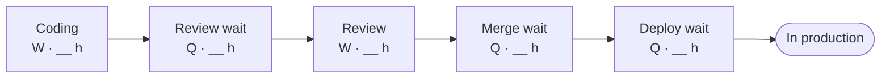

# Relay — Current-State Value-Stream Map

Fill in the median hours from your baseline report. Mark each stage **W** (work: someone is actively changing or reviewing the change) or **Q** (queue: the change is waiting).

## 2026Q1 (baseline, before agents)

| Measure | Value |
| --- | --- |
| Median change lead time | __ h |
| Flow efficiency (work ÷ total) | __ % |
| Largest queue | ________ (__ h) |

## 2026Q2 (after agents)

| Measure | Value |
| --- | --- |
| Median change lead time | __ h |
| Flow efficiency (work ÷ total) | __ % |
| Largest queue | ________ (__ h) |

## What moved, and why

In three to five sentences, with numbers: which stage got faster, which got slower, and where the work went.

## Process what-if: daily deploys

| Measure | 2026Q1 | 2026Q2 |
| --- | ---: | ---: |
| Feature lead time, median, actual (h) | | |
| Feature lead time, median, if deployed every weekday at 15:00 (h) | | |
| Hours saved | | |

Compare this saving with the coding-time saving agents produced. List the assumptions the what-if makes.

## Target state (one improvement)

Name one change to the process (not to the tools) that would shorten the largest queue, the metric that would show it worked, and the guardrail that would show it did not make quality worse.
