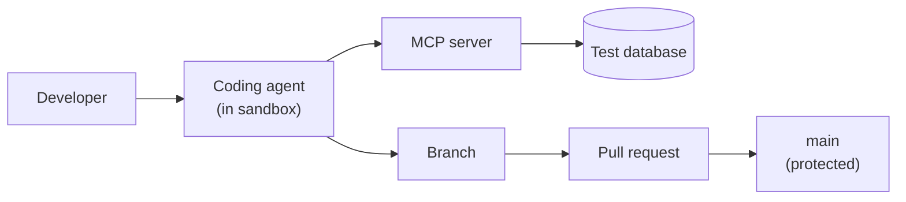

# Workspace Threat Model — <team or repository>

**Author:**
**Reviewed by:** (a person who is not the author)
**Date:**
**Next review:** (at most three months from now, or when the agent, its tools or its permissions change)

## 1. Scope

What is in scope: the developer workstation, the dev container or sandbox, the coding agent, its instructions files, its MCP servers and tools, the repository and its CI. What is out of scope, and why.

## 2. Assets

| Asset | Where it lives | Why an attacker (or a mistaken agent) wants it |
| --- | --- | --- |
| Cloud credentials | | |
| Source code and history | | |
| Secrets (API tokens, database URLs) | | |
| Test and staging data | | |
| The ability to merge to `main` | | |
| | | |

## 3. Actors and trust levels

| Actor | Trust | What it can do today |
| --- | --- | --- |
| Developer | Trusted, accountable | |
| Coding agent | Untrusted output (Chapter 2) acting with delegated permissions | |
| MCP server | Third-party or internal code, run with the agent's permissions | |
| Content the agent reads (tickets, issues, web pages, dependencies) | Untrusted, may contain instructions | |
| CI and branch protection | Trusted control | |

## 4. Trust boundaries

Draw the boundaries (Mermaid is fine): host ↔ sandbox, sandbox ↔ network, agent ↔ MCP server, MCP server ↔ database, branch ↔ `main`. For each boundary say what crosses it and what checks it.

## 5. Threats

At least eight. Include at least one for each row of section 3, and at least one prompt-injection and one tool-poisoning threat (Chapter 12 covers both in depth).

| # | Threat | Entry point | Asset | Likelihood (L/M/H) | Impact (L/M/H) | Control in place | Evidence the control works |
| ---: | --- | --- | --- | --- | --- | --- | --- |
| 1 | Agent runs a destructive command with host credentials | | | | | | |
| 2 | Secret read into agent context and echoed in a pull request or log | | | | | | |
| 3 | Instruction hidden in a ticket steers the agent | | | | | | |
| 4 | MCP server package replaced or its tool description changed | | | | | | |
| 5 | Agent-written change merged without human review | | | | | | |
| 6 | | | | | | | |
| 7 | | | | | | | |
| 8 | | | | | | | |

For "Evidence the control works", cite a test, an audit check ID (Lab 3.1) or a replayed attack (Lab 3.2), not a belief.

## 6. Residual risks

| Risk | Why it is accepted for now | Owner | Review by |
| --- | --- | --- | --- |
| | | | |

## 7. Decisions and follow-ups

What you will change, who owns it, and by when.

## AI-use disclosure

What an agent drafted in this document, and what you verified yourself.
