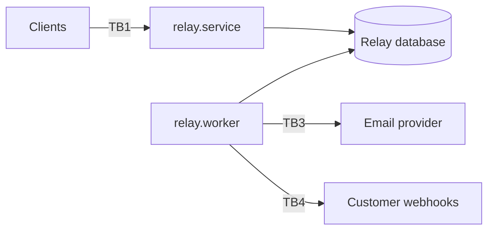

# Threat model — Option A: Modular monolith with an asynchronous triage worker

Option: A
Author: relay-architect-agent
Reviewed by: 
Date: 2026-11-20

## Diagram

## Threats

| # | Boundary | STRIDE | Threat | Control | Evidence |
| ---: | --- | --- | --- | --- | --- |
| 1 | TB1 | S | A stolen token is used to read tasks | Token hashes; 401 on unknown tokens | test_service_app.py::test_v1_routes_need_a_known_token |
| 2 | TB1 | D | One token floods the service | Rate limit of 600 requests per minute |  |
| 3 | TB3 | I | A task title leaves Relay in an email | Emails carry a link only (ESC-N07) | Planned: ESC-AC27 |
| 4 | TB4 | S | Forged webhook events | HMAC-SHA256 signatures | Planned: ESC-AC15 |
