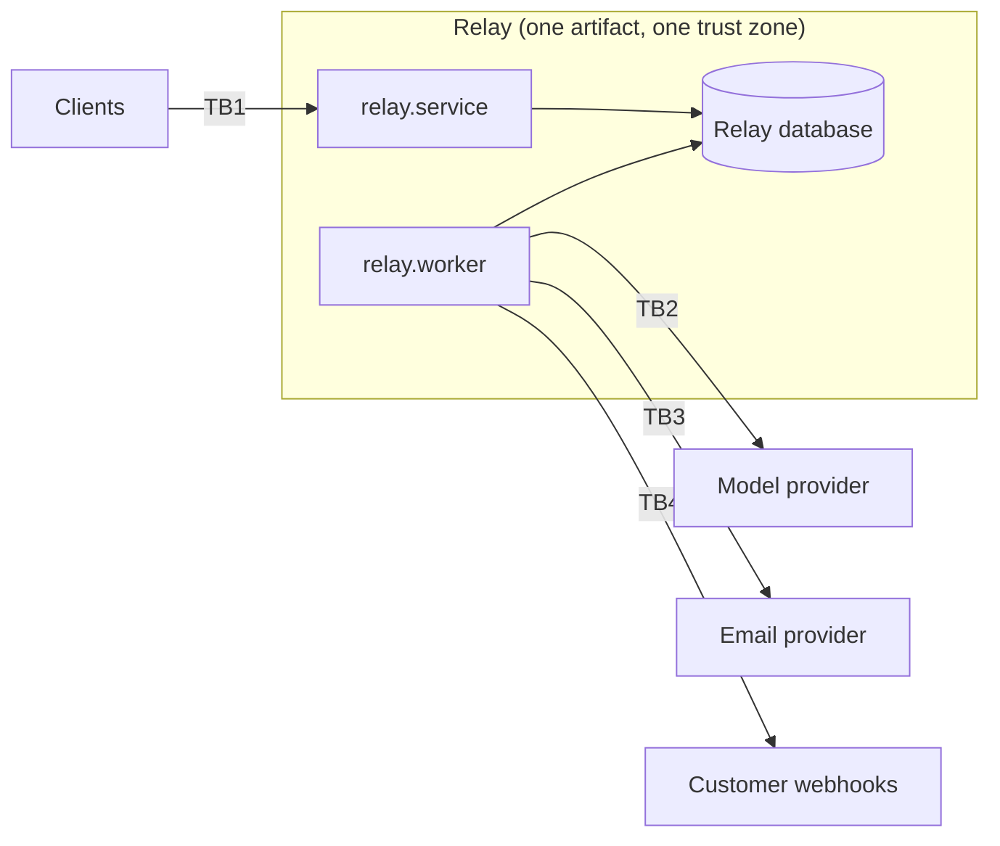

# Threat model — Option A: Modular monolith with an asynchronous triage worker

Option: A
Author: priya.n
Reviewed by: aisha.r
Date: 2026-11-23

## Diagram

## Threats

| # | Boundary | STRIDE | Threat | Control | Evidence |
| ---: | --- | --- | --- | --- | --- |
| 1 | TB1 | S | A stolen or guessed token is used to read tasks | Only SHA-256 token hashes stored; unknown tokens get 401; personal tokens revoked on password reset | relay-repo tests/test_service_app.py::test_v1_routes_need_a_known_token |
| 2 | TB1 | E | A Guest reads a project they were not invited to through the API | Every task route calls relay.roles before returning data | test_service_app.py::test_task_view_goes_through_roles |
| 3 | TB1 | D | One token floods the service | 600 requests per minute per token with 429 and Retry-After; 16 KB body cap | test_service_app.py::test_rate_limit_is_per_token_and_says_when_to_retry; ::test_body_validation |
| 4 | TB1 | T | A retried POST creates duplicate jobs, or a reused key swaps the body | Idempotency-Key required; same key and body replays the job; a different body gets 422 | test_service_app.py::test_replay_with_same_key_returns_the_same_job; ::test_same_key_different_body_is_422 |
| 5 | TB1 | I | Ticket text leaks through error messages or job views | Errors and job views never echo the ticket | test_service_app.py::test_errors_do_not_echo_the_ticket; ::test_job_view_never_contains_the_ticket_text |
| 6 | TB1 | R | A triage submission cannot be traced to the user who made it | Jobs record workspace and idempotency key, not the user | Residual risk, owner sam.o: add the submitting user to triage_jobs before the pilot |
| 7 | TB2 | T | An injected ticket steers the suggested priority | Suggestions never apply themselves; a person confirms or overrides (D3, ESC-N01) | tests/test_worker_runner.py::test_an_injected_ticket_can_steer_a_suggestion_but_nothing_applies_it |
| 8 | TB2 | I | Ticket text with customer data is sent to the model provider | Provider's data-handling terms checked before any real data is sent (Chapter 2); synthetic tickets in labs | Residual risk, owner aisha.r: provider terms review recorded before production use |
| 9 | TB2 | D | The model is slow or unavailable and triage stalls | Durable queue; 10 s timeout; 3 attempts with backoff, then a person's queue; heartbeat and 5-minute stall flag | test_worker_runner.py::test_slow_answer_is_a_timeout_and_is_retried; ::test_unavailable_three_times_goes_to_a_person; ::test_stall_rule_is_five_minutes |
| 10 | TB2 | T | Malformed model output is stored as a suggestion | Strict schema validation; nothing is repaired | test_worker_runner.py::test_parse_suggestion_rejects_extra_fields_bad_enums_and_bad_confidence |
| 11 | TB3 | I | A task title leaves Relay in an escalation email | Emails carry the link, priority, rule and step only (ESC-N07) | Planned: ESC-AC27, written test-first in Chapter 8 |
| 12 | TB4 | S | Customers accept forged task.escalated events | HMAC-SHA256 signature in X-Relay-Signature, as for every Relay webhook | Planned: ESC-AC15, written test-first in Chapter 8 |
| 13 | none | E | A compromised worker process reads or writes every table | Module ownership enforced in code by fitness tests; one database role for both processes in 4.19.0 | tests/test_architecture.py AR1-AR5; residual risk, owner sam.o: separate database roles (Chapter 11) |
