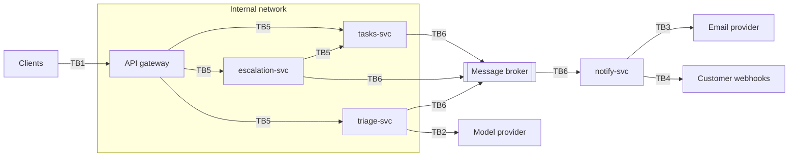

# Threat model — Option B: Microservices with a message broker

Option: B
Author: priya.n
Reviewed by: aisha.r
Date: 2026-11-23

## Diagram

## Threats

| # | Boundary | STRIDE | Threat | Control | Evidence |
| ---: | --- | --- | --- | --- | --- |
| 1 | TB1 | S | A stolen or guessed token is used at the gateway | Token hashes at the gateway; 401 | None yet: option not built |
| 2 | TB1 | D | One token floods the gateway | Gateway rate limit, 600 per minute per token | None yet: option not built |
| 3 | TB1 | I | Ticket text leaks through gateway error pages | Gateway never echoes bodies | None yet: option not built |
| 4 | TB5 | S | A compromised service calls another while claiming to be the gateway | Service identity and mutual TLS between every pair of services | None yet: needs workload identity (Chapter 14) |
| 5 | TB5 | E | A service skips the permission check that the gateway assumed it would make | Every service calls relay.roles' equivalent; shared contract tests | None yet: contract tests per service pair |
| 6 | TB5 | R | A request's actions cannot be traced across services | Propagated request IDs and per-service audit logs, each kept 400 days | None yet: tracing (Chapter 16) |
| 7 | TB6 | I | Task titles sit in broker topics and their retention | Events carry IDs only; consumers fetch content they are allowed to see | None yet: schema review of every event type |
| 8 | TB6 | T | A forged or replayed event fires a step twice | Broker authentication per service; consumers deduplicate on event IDs | None yet: idempotent consumers in four services |
| 9 | TB6 | D | The broker is down and no step fires | Outbox tables in each producer; alerts on broker lag | None yet: broker operated by the team |
| 10 | TB2 | T | An injected ticket steers the suggested priority | Consumers ignore unconfirmed suggestions (D3) | None yet: a contract rule in each consumer |
| 11 | TB2 | I | Ticket text with customer data is sent to the model provider | Provider terms checked first (Chapter 2) | Residual risk, owner aisha.r |
| 12 | TB2 | D | The model is slow and triage-svc backs up | Queue and timeouts in triage-svc | None yet: option not built |
| 13 | TB3 | I | A task title leaves Relay in an email | notify-svc renders links only (ESC-N07) | None yet: option not built |
| 14 | TB4 | S | Customers accept forged webhook events | HMAC-SHA256 signatures in notify-svc | None yet: option not built |
