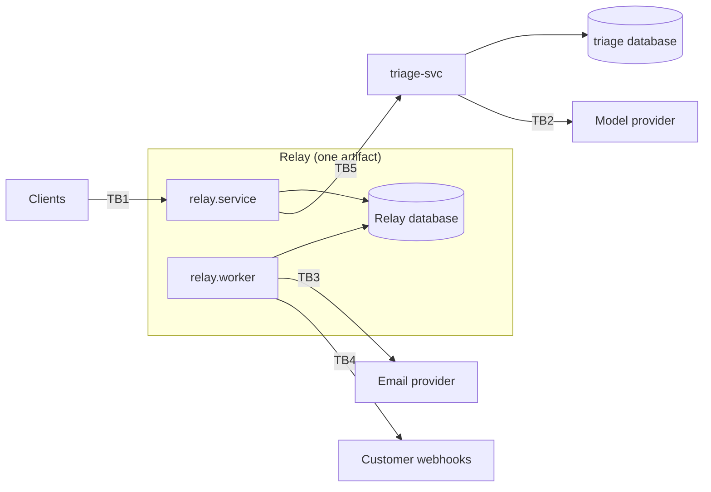

# Threat model — Option C: Modular monolith with a separate triage service

Option: C
Author: priya.n
Reviewed by: aisha.r
Date: 2026-11-23

## Diagram

## Threats

| # | Boundary | STRIDE | Threat | Control | Evidence |
| ---: | --- | --- | --- | --- | --- |
| 1 | TB1 | S | A stolen or guessed token is used to read tasks | Only SHA-256 token hashes stored; unknown tokens get 401 | relay-repo tests/test_service_app.py::test_v1_routes_need_a_known_token |
| 2 | TB1 | D | One token floods the service | 600 requests per minute per token; 16 KB body cap | test_service_app.py::test_rate_limit_is_per_token_and_says_when_to_retry |
| 3 | TB1 | I | Ticket text leaks through error messages | Errors never echo the ticket | test_service_app.py::test_errors_do_not_echo_the_ticket |
| 4 | TB5 | S | Another process on the internal network calls triage-svc as Relay | Service identity and mutual TLS between Relay and triage-svc | None yet: workload identity (Chapter 14) |
| 5 | TB5 | I | Ticket text is read in transit to triage-svc | TLS on the internal network | None yet: option not built |
| 6 | TB5 | T | triage-svc's answer is applied to a task | Relay stores suggestions only (D3, ESC-N01) | None yet: a contract test at TB5 |
| 7 | TB2 | T | An injected ticket steers the suggested priority | Suggestions only; a person confirms (D3) | None yet: triage-svc's own tests |
| 8 | TB2 | I | Ticket text with customer data is sent to the model provider | Provider terms checked first (Chapter 2) | Residual risk, owner aisha.r |
| 9 | TB2 | D | The model is slow and triage-svc backs up | Queue, timeouts and a person's queue in triage-svc | None yet: option not built |
| 10 | TB3 | I | A task title leaves Relay in an email | Emails carry the link, priority, rule and step only | Planned: ESC-AC27, written test-first in Chapter 8 |
| 11 | TB4 | S | Customers accept forged task.escalated events | HMAC-SHA256 signature in X-Relay-Signature | Planned: ESC-AC15, written test-first in Chapter 8 |
| 12 | none | E | A compromised escalation worker reads or writes every table in Relay's database | One database role for the monolith's two processes | Residual risk, owner sam.o: separate database roles (Chapter 11) |
