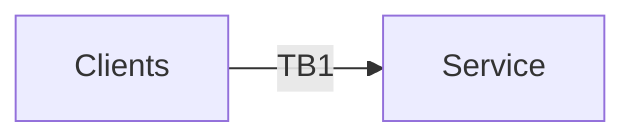

# Threat model — Option <X>: <name>

Option: <X>
Author: <name>
Reviewed by: <a person who is not the author>
Date: YYYY-MM-DD

<!--
One threat model per architecture option, chosen or not (Chapter 6, Security lens).
The checker (python -m archscore.report threats --options ../data/options <this file>) enforces:
- Every trust boundary in the option's JSON file (TB1, TB2, ...) appears in the diagram and in at least one threat.
- Boundary is a TB ID, or "none" for a threat inside one trust zone.
- STRIDE is one or more of S, T, R, I, D, E, separated by "/" or ",".
- Every threat has a control, and every control has evidence: a test name, an audit check, a planned test
  with its chapter, "None yet: <the work needed>" for an option that is not built, or "Residual risk, owner <name>".
- A reviewer who is not the author.
Use the four questions from Chapter 3: what are we working on, what can go wrong, what will we do about it,
did we do a good job?
-->

## Diagram

## Threats

| # | Boundary | STRIDE | Threat | Control | Evidence |
| ---: | --- | --- | --- | --- | --- |
| 1 | TB1 | S | | | |
| 2 | | | | | |
